# China Enterprise Calendar Guard

A Dify workflow that answers one question correctly: **is this date actually a working day in China?**



## The problem

Chinese public holidays are not the hard part. **调休 (tiáoxiū) is.**

When a public holiday falls near a weekend, the State Council moves working days onto the adjacent Saturday or Sunday. Those days **look** like weekends in every calendar application and are **not** — they are compulsory working days.

The result is a meeting booked on what the organiser's calendar shows as a Sunday, sent to a team that is at their desks. Generic weekend detection cannot see this, and neither can a holiday list, because the answer is neither "holiday" nor "weekend".

This workflow checks the makeup-workday case **first**, before holidays and before weekends, because it is the case every other tool gets wrong.

## Import it

1. Download [`calendar-guard.yml`](calendar-guard.yml).
2. In Dify, go to **Studio → Create App → Import DSL File**, and select the file.
3. Install the **DeepSeek** provider plugin (`langgenius/deepseek`) from the Marketplace if it is not already present.
4. The `Extract Date` node calls DeepSeek in structured-output mode — confirm the model is available in your workspace, or substitute a comparable model with JSON output.
5. Run it with any natural-language request, for example: *"Can we book the review meeting on Saturday 10 October 2026?"*

No API key is stored in the export. Dify asks for the provider credential on import.

## How it works

```
User input  (user_request, requester, today)
   |
   v
Extract Date -- LLM (DeepSeek)
   |  -> { date, confidence }
   v
Calendar Guard -- Python 3 code node
   |
   v
Is Bookable? -- if-else on is_valid_meeting_day
   |-- true  -> Answer Valid    "{date} ({weekday}) is a normal working day."
   |-- false -> Answer Invalid  "Do not schedule this meeting. {date} ({weekday}) - reason: {day_kind}"
   |
   v
Final Answer -- variable-aggregator
   |
   v
Output  (final_answer, date, day_kind, is_valid_meeting_day)
```

### The decision order

The code node evaluates in this sequence, and the order is the whole point:

| # | Check | `day_kind` | Bookable |
|---|-------|-----------|----------|
| 1 | In the 调休 makeup-workday list | `makeup_workday` | **No** — "It LOOKS like a weekend and is NOT." |
| 2 | Inside a public-holiday range | `public_holiday` | No |
| 3 | Saturday or Sunday | `weekend` | No |
| 4 | None of the above | `workday` | **Yes** |

## 2026 schedule

Hardcoded and citable, per **国办发明电〔2025〕7号** (published 2025-11-04).

**Holidays (7 ranges)**

| Holiday | Range |
|---|---|
| New Year's Day | 01-01 → 01-03 |
| Spring Festival | 02-15 → 02-23 |
| Qingming Festival | 04-04 → 04-06 |
| Labour Day | 05-01 → 05-05 |
| Dragon Boat Festival | 06-19 → 06-21 |
| Mid-Autumn Festival | 09-25 → 09-27 |
| National Day | 10-01 → 10-07 |

**调休 makeup workdays (6 days)**

| Date | Day | Swapped for |
|---|---|---|
| 2026-01-04 | Sun | New Year |
| 2026-02-14 | Sat | Spring Festival |
| 2026-02-28 | Sat | Spring Festival |
| 2026-05-09 | Sat | Labour Day |
| 2026-09-20 | Sun | National Day |
| 2026-10-10 | Sat | National Day |

## Outputs

`is_valid_meeting_day` · `date` · `weekday` · `day_kind` · `holiday_name` · `is_makeup_workday` · `needs_human_review` · `message`

`day_kind` is one of `workday` · `weekend` · `public_holiday` · `makeup_workday` · `unresolved` · `unparseable`.

## Safety behaviour

- **Defensive parsing.** Empty input, `none`, `null` and malformed strings cannot crash the workflow — they return `day_kind: unresolved` or `unparseable` with `is_valid_meeting_day: false`.
- **Fail closed.** When the date cannot be resolved, the answer is "do not book", not a guess.
- **Confidence surfaced.** When the LLM's extraction confidence is not `high`, the response sets `needs_human_review: true` so the caller can double-check rather than trust it.
- **No external calls.** The decision is deterministic Python against a hardcoded, cited schedule. The model is used only to turn a sentence into a date.

## Limitations

- **The schedule is 2026 only.** It is a code-level constant, not a live feed. It needs one annual update when the State Council publishes the next notice — until then, 2027 dates fall through to plain weekend logic.
- **The LLM only extracts dates.** Ambiguous input ("next Friday after the holiday") depends on the model's interpretation; `needs_human_review` is the mitigation, not a guarantee.

## Files

| File | Purpose |
|---|---|
| `calendar-guard.yml` | Dify application DSL export — import this into a Dify workspace |
| `docs/workflow-graph.png` | The workflow graph as built in Dify |

## License

MIT. See [LICENSE](LICENSE).
